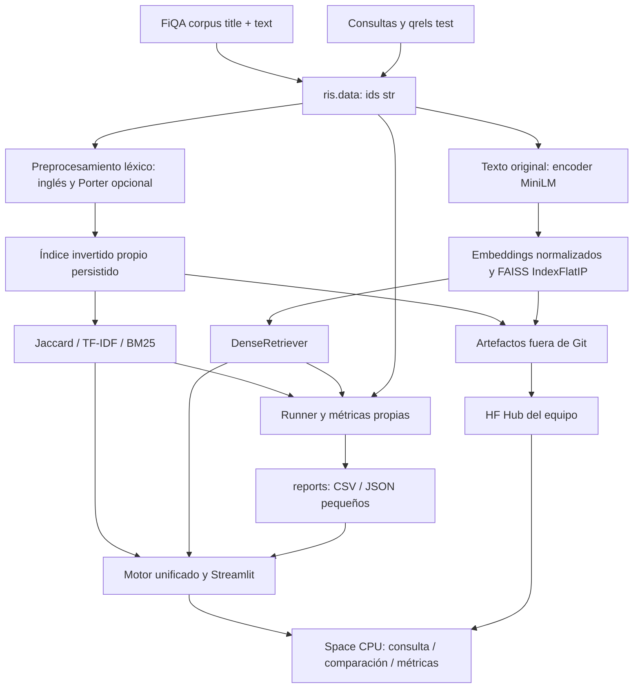

# Plan del proyecto de Recuperación de Información

Plan base: lunes 9 de noviembre de 2026. Repositorio público universitario: [Vladimirjon/Retrieval_Information_System](https://github.com/Vladimirjon/Retrieval_Information_System).

## Objetivo y fuentes

Construir un sistema reproducible que compare Jaccard binario, coseno TF-IDF, BM25 y recuperación semántica sobre FiQA, con consultas libres, rankings, evaluación con qrels e interfaz web desplegada.

Fuente de verdad de requisitos: [ESPECIFICACION](ESPECIFICACION.md), transcripción completa del profesor. Fuente de cifras verificadas: [DATASET](DATASET.md), consultada el 9 de noviembre. Reparto, fórmulas concretas, contratos, stack y plazos internos son **decisiones del equipo para este plan**, no exigencias adicionales atribuidas al profesor. Las cifras de rendimiento y consumo aún deben medirse.

Entrega oficial: **23 de noviembre de 2026**, según el enunciado. Fecha interna del equipo: **martes 17 de noviembre de 2026, todo terminado: código, despliegue e informe**. Del 18 al 23 solo contingencia; no se asigna trabajo a ese período.

## Cobertura del enunciado

Las issues #1–#18 ya están creadas en GitHub con esta numeración; [TASKS](../TASKS.md) es su índice completo.

| Fuente | Requisito o entregable completo | Issues que lo cubren y evidencia esperada |
|---|---|---|
| Objetivo | Comparar modelos clásicos y modernos; consultas, rankings y evaluación | #5–#16: cuatro recuperadores, resultados y app |
| a | Leer corpus de documentos textuales | #2: title+text como texto plano, ids y conteos verificados |
| a | Tokenizar, normalizar y remover stopwords | #3: pipeline inglés y tests; #4: EDA |
| a | Índice invertido: término, documentos y frecuencia | #5: postings, df, longitudes, persistencia y tests |
| b | Jaccard con vectores binarios | #6: implementación propia y ejemplos manuales |
| b | Coseno con TF-IDF | #7: pesos, L2 y ejemplos manuales |
| b | BM25 | #8: fórmula y tests con k1/b documentados |
| b | Consultas de texto libre y ranking por relevancia | #6–#8 y #13: search, orden y top-n |
| c | Embeddings preentrenados para corpus | #9: modelo, dimensiones, lotes y artefactos reproducibles |
| c | Embeddings para consultas libres | #9: encoder de consulta y test de recuperación |
| c | Almacenar embeddings en base vectorial FAISS o ChromaDB | #9: FAISS IndexFlatIP persistido |
| c | Búsqueda vectorial y ranking por similitud | #9 y #13: top-k exacto, scores e ids |
| d | Interfaz web desplegada en servicio gratuito | #13 y #16: Streamlit, Space y URL pública comprobada |
| d | Consultar y elegir Binario, TF-IDF, Probabilístico o Embeddings | #13: selector y consulta compartida |
| d | Visualizar top-n en los modelos | #13: n configurable, documentos y scores |
| d | Comparar resultados entre modelos | #14: vista lado a lado y solapamiento |
| d | Visualizar métricas de evaluación | #15: tablas/gráficos desde reports/ |
| e | Consultas de prueba y documentos relevantes (qrels) | #2 y #11: ids str, selección test y conteos |
| e | Precisión y recall por consulta | #10 y #11: P@10/R@10, k configurable y CSV por consulta |
| e | MAP para todo el sistema | #10 y #11: MAP@1000 validado manualmente y resumen |
| f | Comparar los cuatro modelos | #11, #12 y #14: métricas y rankings comparables |
| f | Analizar tipos de consultas donde funciona mejor cada modelo | #12: agrupación razonada y casos concretos |
| f | Casos donde semántico mejora o empeora frente a BM25/TF-IDF | #12 y #17: ejemplos trazables a qrels y posiciones |
| Requisitos técnicos | Lenguaje sugerido Python y bibliotecas permitidas | #1: Python 3.12, dependencias exactas compatibles |
| Requisitos técnicos | Base vectorial obligatoria y sin Elasticsearch/Solr/Whoosh | #9: FAISS; #5–#8 y #18: comprobar prohibiciones |
| Requisitos técnicos | Modelos clásicos propios o claramente explicados | #5–#8 y #17: implementaciones propias, fórmulas y tests; tampoco rank_bm25 |
| Entregable 1 | URL del despliegue | #16 y #18: URL verificada y publicada en readme.md |
| Entregable 2 | Código fuente e instrucciones claras README | #1–#16 y #18: código, instalación limpia, reproducción y readme.md final |
| Entregable 3 | Informe técnico de máximo 5 páginas | #17 y #18: fuente y PDF renderizado, conteo y revisión visual |
| Entregable 3, sección 1 | Descripción del corpus utilizado | #4 y #17: EDA y cifras verificadas |
| Entregable 3, sección 2 | Explicación de decisiones de diseño | #5–#10 y #17: fórmulas, arquitectura y motivos |
| Entregable 3, sección 3 | Ejemplos de consultas y resultados | #12 y #17: qids, texto y rankings concretos |
| Entregable 3, sección 4 | Análisis de métricas de evaluación | #11, #12 y #17: P@10, R@10 y MAP@1000 |
| Materiales del profesor | Usar corpus/queries y qrels FiQA indicados | #2 y #4: carga desde BeIR/fiqa y BeIR/fiqa-qrels |

## Arquitectura y flujo

La consulta léxica usa el mismo preprocess y stem del índice; la consulta densa usa el encoder sobre texto original. La app carga recursos una vez con caché, no recalcula embeddings del corpus. La evaluación offline alimenta la vista de métricas. El corpus, los índices y sus metadatos se transportan fuera de GitHub con correspondencia explícita de ids.

Estructura prevista: src/ris/{data,preprocessing,index,retrievers,evaluation}, scripts/build_artifacts.py, scripts/evaluate.py, app/streamlit_app.py, app/views/, tests/, notebooks/, reports/ y docs/informe/. Solo documentación y configuración de GitHub en esta preparación; la estructura ejecutable nace en #1 y las issues siguientes.

## Decisiones técnicas y motivos

| Decisión del equipo | Motivo y comprobación prevista |
|---|---|
| Python 3.12, paquete src/ris/, requirements.txt con versiones exactas | Entorno coherente y módulos importables; #1 comprueba compatibilidad real e instalación limpia. pytest/ruff y GitHub Actions lint+tests en cada PR reducen regresiones. Versiones se fijan en #1, no se inventan aquí. |
| FiQA inglés; documento=title+text | Dataset proporcionado por el profesor, con consultas y qrels disponibles. Conservar title aunque esté vacío evita perder contenido en filas que sí lo tengan. #2 verifica tipos y #4 caracteriza texto. |
| Stopwords NLTK inglés y Porter configurable | Coherencia lingüística; evaluar con/sin stemming permite medir su efecto en clásicos sin suponer mejora. El denso conserva texto original. |
| Índice propio term → {doc_id: tf}, df y longitudes persistidas | Cumple a y permite compartir estadísticas entre clásicos, evitar reconstruir en cada arranque y explicar fórmulas. NumPy/SciPy dispersas son auxiliares; sin motores completos ni rank_bm25. |
| Jaccard binario | Baseline de coincidencia de conjuntos, independiente de repeticiones. Score = tamaño(intersección)/tamaño(unión); unión vacía aporta 0. |
| TF-IDF con tf log e idf ln(N/df), L2 | Reduce peso de repeticiones y términos comunes; L2 permite coseno comparable. tf=1+ln(tf) si tf>0 y 0 si no; documentos y consultas usan mismos pesos sin suavizado. Norma cero devuelve ranking vacío. |
| BM25, k1=1.5 y b=0.75 | Saturación de tf y corrección de longitud, con parámetros fijados por el equipo y documentados, sin afinarlos con test. Variante adoptada: idf=ln(1+(N-df+0.5)/(df+0.5)); score suma idf × tf×(k1+1)/(tf+k1×(1-b+b×dl/avgdl)) para términos únicos de consulta. avgdl=0 devuelve ranking vacío. |
| MiniLM all-MiniLM-L6-v2, 384 dimensiones y FAISS IndexFlatIP | Modelo compacto para presupuesto CPU; vectores L2 normalizados hacen que producto interno sea coseno. Búsqueda exacta evita introducir aproximación como variable experimental. Registrar revisión, truncamiento y configuración en #9. |
| FiQA test; P@10/R@10, k configurable y MAP@1000 | Qrels independientes para evaluación; precisión y recall caracterizan top-k y MAP resume orden. Corte de 1000 adoptado como convención TREC por el equipo; AP divide por todos los relevantes. No reportar MAP sin indicar corte ni ajustar hiperparámetros con test. |
| nDCG@10 opcional | Permite comparación con publicaciones BEIR solo si se confirma la fuente y la configuración; no bloquea mínimos. No citar valores publicados aún sin verificar. |
| Streamlit y Hugging Face Spaces CPU básico, gratis | Interfaz rápida de implementar. El equipo descarta Render gratis por su límite de 512 MB indicado en el encargo y el conjunto modelo+torch+índices; descarta Vercel por tamaño de torch en funciones serverless. Estas restricciones son el fundamento recibido, no mediciones propias: #16 comprueba capacidad real del Space y modalidad compatible con Streamlit. |
| Render con app reducida, plan B | Inferencia del equipo, no probado: reducir carga podría permitir otro despliegue. No sustituye la obligación de entregar los cuatro modelos ni autoriza un plan de pago. |
| Artefactos fuera de Git; construcción una vez y distribución por Hub | Evita repositorio pesado y cómputo repetido. scripts/build_artifacts.py genera índice, embeddings y FAISS; portátil o Google Colab gratis para cálculo, repo Hub del equipo para almacenamiento y descarga al arrancar. Revisiones y hashes permiten reproducir e inspeccionar integridad. |
| Solo CSV/JSON pequeños de evaluación en reports/ | Facilita revisión de métricas e informe y permite que la app muestre resultados sin evaluar todo en línea. |

Datos verificados en [DATASET](DATASET.md): 57 638 documentos, 6 648 consultas globales y 1 706 filas de qrels test con score=1. Consultas sin split propio: filtrar por query-id de los qrels. Convertir ids numéricos a str. Las **648 consultas test únicas siguen pendientes de contar** en #2; no confundir filas de juicios con consultas. Valores BEIR sin verificar no son resultados del proyecto.

Costos: Space CPU básico y Colab se usarán en modalidad **gratis**; no se configura facturación. Las suscripciones de herramientas de agentes **usan su cupo**. El uso gratuito de NVIDIA se limita al contenido público universitario; ningún secreto se envía a proveedores. Un cambio a hardware/plan/API **de pago por uso** dispararía cobros según ese proveedor y exige antes informar la tarifa y obtener aprobación; no está autorizado por este plan.

## Contratos de interfaz y archivos compartidos

Estos contratos también rigen en [AGENTS](../AGENTS.md).

| Módulo | Contrato |
|---|---|
| ris.data | load_corpus() → dict[str, Doc], Doc con title: str y text: str; load_queries(split="test") → dict[str, str]; load_qrels(split="test") → dict[str, dict[str, int]]. Todos los ids str. |
| ris.preprocessing | preprocess(text: str, *, stem: bool = False) → list[str]. Mismo pipeline clásico para corpus y consultas. |
| ris.index | Clase InvertedIndex con postings, df, longitudes, N y save/load con ruta. Persistir stem y versión de formato. |
| ris.retrievers | Protocolo Retriever: search(query: str, k: int = 10) → list[Result]; Result(doc_id: str, score: float). JaccardRetriever, TfidfRetriever, BM25Retriever, DenseRetriever. |
| ris.evaluation | precision_at_k(ranking, relevant, k=10), recall_at_k(ranking, relevant, k=10), average_precision(ranking, relevant, k=1000), mean_average_precision(run, qrels). run=dict[qid, list[doc_id]] ordenado. relevant=conjunto de ids con score>0. |
| app | app/streamlit_app.py; #13 fija render(context) para app/views/comparison.py y app/views/metrics.py antes de #14/#15. Motor y cargador únicos compartidos. |
| reports | metrics_per_query.csv con model, stem, qid, k, precision, recall, ap_at_1000; metrics_summary.json con configuración, conteos, versiones y promedios por model/stem. #11 publica esquema completo antes de #15. |
| Análisis e informe | notebooks/ para EDA/comparación; docs/informe/ para fuente y PDF final; reports/ para tablas pequeñas reproducibles. |

Rankings: score descendente, desempate por doc_id ascendente y sin duplicados. Consulta vacía devuelve []; k no positivo produce ValueError; puede haber menos de k resultados. No comparar magnitudes de scores de modelos distintos como si estuvieran calibrados.

Métricas: P@k divide por k incluso con ranking corto; R@k y AP@1000 dividen por todos los relevantes de la consulta. MAP@1000 promedia todas las consultas de qrels, incluidas las que no tengan ranking (0). Consulta sin relevantes aporta 0; ranking duplicado o k inválido se rechaza con ValueError. Ejemplo manual: relevantes {a,c}, ranking [a,b,c], P@2=R@2=0.5 y AP@1000=5/6. Con otra consulta sin aciertos, MAP=5/12. #10 añade caso con relevante fuera del corte para evitar confundir AP truncada y denominador truncado.

## Responsabilidades

| Persona | Issues | Alcance y coordinación |
|---|---|---|
| Vladimirjon (@Vladimirjon) | #1, #2, #5, #7, #8, #9, #11, #13, #16, #18 | Mayor carga y piezas críticas: estructura/CI, datos, índice, TF-IDF/BM25, embeddings/FAISS, runner, núcleo/carga de app, Hub/Space, QA, README final y checklist. Líder técnico y CODEOWNER. |
| Ismael Freire (usuario de GitHub pendiente) | #3, #6, #10, #14 | Preprocesamiento, Jaccard sobre InvertedIndex, métricas con tests a mano y comparación lado a lado/solapamiento. |
| Jorge Torres (usuario de GitHub pendiente) | #4, #12, #15, #17 | EDA, análisis por tipos de consulta, vista de métricas desde reports/ e informe de máximo 5 páginas con aportes del equipo. |

Claude Code orquesta; Codex, Gemini y modelos NVIDIA ejecutan encargos acotados según disponibilidad y privacidad. No se consideran colaboradores humanos ni revisores independientes si operan con la misma cuenta. Se coordina quién toca scripts/build_artifacts.py y el núcleo de app; compañeros implementan sus vistas separadas. No se delega dos veces el mismo trabajo.

## Cronograma diario y milestones

Fechas del acuerdo del equipo; criterios detallados en las issues. Las métricas #10 vencen el 12 para permitir ejecutar #11 el 13, aunque pertenecen a M3.

| Día real | Trabajo y cierre previsto | Milestone y fecha límite |
|---|---|---|
| Lun 9 noviembre | Planificación, verificación remota y preparación de PR; añadir colaboradores | Ruleset, seis milestones, 12 etiquetas e issues #1–#18 creados y verificados por API |
| Mar 10 | Vladimirjon #1→#2; Ismael #3 tras #1; Jorge #4 tras #2/#3, con datos listos temprano | M0 Base y datos — 2026-11-10 |
| Mié 11 | Vladimirjon #5 y primer lote #9; Ismael #10 y arranque #6 tras índice; Jorge revisa EDA y prepara esquema del informe | M1 y M2 en paralelo, según contratos |
| Jue 12 | Cerrar #6/#7/#8, #9 y #10; validar métricas, persistencia y carga conjunta | M1 Modelos clásicos — 2026-11-12; M2 Recuperación semántica — 2026-11-12 |
| Vie 13 | Vladimirjon #11; Jorge inicia #12 con resultados; arrancar #13 y acordar contratos de vistas | M3 en ejecución, app iniciada |
| Sáb 14 | Jorge cierra #12; Vladimirjon cierra #13; Ismael/Jorge avanzan #14/#15 sobre contratos de app ya fijados | M3 Evaluación y comparación — 2026-11-14 |
| Dom 15 | Cerrar #14/#15 temprano y luego #16: Hub, Space y recorrido público completo | M4 Interfaz y despliegue — 2026-11-15 |
| Lun 16 | Jorge cierra #17, con revisión de aportes de los demás; Vladimirjon ejecuta QA y README de #18 | M5 en ejecución |
| Mar 17 | Cerrar #18: regresiones, informe ≤5 páginas, URL/README, checklist y entrega con constancia | M5 Informe y entrega — 2026-11-17 |

No hay hitos ni trabajo asignado del 18 al 23. Si una dependencia se retrasa se replanifica dentro del 17 o se escala el incumplimiento; no se oculta trasladándolo al colchón.

## Dependencias y camino crítico

Dependencias de integración (se puede preparar interfaz o fixtures antes, sin declarar finalizada la issue):

- #1 → #2 y #3; #2 + #3 → #4 y #5.
- #5 → #6, #7, #8; #2 → #9, independiente del índice clásico; #1 → #10.
- #6 + #7 + #8 + #9 + #10 → #11 → #12.
- #6 + #7 + #8 + #9 → #13; #13 → #14; #11 + #13 → #15.
- #9 + #13 + #14 + #15 → #16.
- #4 + #12 + #16 → #17; #16 + #17 → #18.

Camino crítico previsto por calendario: **#1 → #2/#3 → #5 → #6/#7/#8 → #11 → #12 → #17 → #18**. La rama **#2 → #9 → #13 → #14/#15 → #16 → #17** también puede gobernar el cierre si embeddings, memoria o app se retrasan. Es una inferencia de planificación: no hay duraciones medidas que prueben un único camino crítico. Por eso #9 empieza temprano con un lote pequeño y #13 arranca el 13. #4 concentra datos y análisis en un día; se debe disponer de #2/#3 temprano el martes.

Puntos de control: M0 prueba carga/preprocesamiento y conteos; M1/M2 prueba rankings, persistencia y fórmulas; M3 verifica evaluación completa y casos; M4 prueba sitio público; M5 revisa todo e informe renderizado. No confundir un milestone vencido con trabajo terminado.

## Flujo de trabajo Git y revisión

1. Leer STATE/TASKS/AGENTS, comprobar estado Git y tomar issue con dependencias disponibles.
2. Rama tipo/NN-descripcion (NN=número de issue, cero inicial hasta 09); Conventional Commits. Esta planificación usa la rama ya existente docs/01-plan-inicial y antecede a #1.
3. Un PR por issue con Closes #NN; describir cambios y evidencia. Nombrar archivos al añadir: nunca git add .; conservar trabajo ajeno. No commit/push sin encargo.
4. Ejecutar pruebas pertinentes, lint y revisar diff. Desde #1, GitHub Actions ejecuta lint+tests en cada PR. No afirmar que esos checks sean reglas obligatorias del ruleset: no se ha indicado esa configuración.
5. Resolver hilos; los PR de Ismael y Jorge requieren aprobación vigente de CODEOWNER @Vladimirjon. Los commits nuevos descartan aprobaciones; los PR de Vladimirjon siguen el bypass admin descrito abajo.
6. Solo Vladimirjon, o Claude Code con su cuenta cuando él lo pida, hace merge vía PR; la rama se elimina automáticamente. Actualizar STATE/TASKS al terminar la tarea.

Reglas remotas verificadas por API el 9 de noviembre de 2026: ruleset `proteger-main` (id 26888439) activo sobre la rama por defecto, con reglas `deletion`, `non_fast_forward`, `update` y `pull_request`; exige 1 aprobación, CODEOWNER, descarta aprobaciones con commits nuevos y requiere resolver hilos. El rol admin tiene bypass en modo `pull_request`, por lo que Vladimirjon puede integrar sus propios PR mediante ese bypass tras pasar CI (desde #1). No habilita push directo. El borrado automático de ramas al hacer merge está activado. También están creados los seis milestones M0–M5 con las fechas del plan, 12 etiquetas (9 de área y 3 `resp:*`) y las 18 issues #1–#18; las asignadas a Ismael y Jorge esperan que se unan como colaboradores.

**Aprobaciones y bypass:** [GitHub no permite al autor aprobar su propio PR](https://docs.github.com/en/pull-requests/how-tos/review-pull-requests/approving-a-pull-request-with-required-reviews), pero el ruleset verificado permite al rol admin omitir ese requisito mediante bypass `pull_request`. Los PR de Ismael y Jorge requieren aprobación de @Vladimirjon como CODEOWNER; Vladimirjon (o Claude Code con su cuenta, cuando él lo pida) realiza el merge. Los PR de Vladimirjon se integran con el bypass de admin después de pasar CI (desde #1); cuando haya tiempo, se recomienda una revisión no bloqueante de un compañero o una revisión cruzada de otro modelo de IA.

Sin atribución de IA en commits, PRs, issues o documentos: ni Co-Authored-By ni “Generated with”. CODEOWNERS local asigna todos los archivos a @Vladimirjon; la plantilla pide evidencia y checklist.

## Riesgos y mitigaciones

| Riesgo | Mitigación y responsable |
|---|---|
| Embeddings consumen más tiempo/cupo del previsto | #9 mide lote pequeño, ajusta batch y estima total; calcular una vez en portátil o Colab gratis; Vladimirjon inicia el 11. No inventar tiempos de ejecución. |
| Memoria o arranque lento del Space | #9/#13 miden consumo y evitan duplicar modelos; #16 prueba corpus completo, caché y arranque en frío. Revisar carga de matrices e índice; Render reducido sigue como inferencia y debe conservar mínimos. Escalar antes de pagar. |
| Compañeros se retrasan | Contratos y fixtures reducen espera; seguimiento diario por milestone; Vladimirjon coordina apoyo de agentes en la misma issue antes del 17 y revisa la entrega. No cambiar responsables silenciosamente. |
| Métricas o selección test erróneas | #2 convierte ids y cuenta consultas; #10 ejemplos a mano y caso de corte; #11 compara integración. Todos los modelos comparten test y definiciones. |
| Stemming o ids de embeddings no corresponden a artefactos | Guardar stem, revisiones, versión, hashes y mapeo fila-doc_id; rechazar carga incompatible. |
| Variantes de fórmulas impiden reproducir | Fijar tf/idf, BM25 y desempate en contratos; no tunear con test. Documentar también truncamiento del denso y límites de comparación con BEIR. |
| Dependencias incompatibles con Python 3.12/CPU | #1 fija versiones exactas con instalación limpia; #9 valida FAISS/torch y #16 misma base CPU del despliegue. |
| Falta de colaboradores o riesgo de integrar sin revisión | Añadir a Ismael y Jorge como colaboradores y asignar sus issues. Los PR de Vladimirjon usan el bypass admin tras pasar CI; cuando haya tiempo, obtener revisión no bloqueante de un compañero o revisión cruzada de otro modelo. |
| Informe supera 5 páginas o tablas no se leen | #17 renderiza, cuenta y revisa visualmente todas las páginas el 16; #18 verifica entregable final el 17. |
| Canal de entrega aún no especificado | Confirmarlo con profesor/equipo antes de #18; registrar constancia real, sin asumir que publicar repo equivale a entregar. |

## Definición de terminado

Una issue está terminada cuando cumple todos sus criterios, tiene pruebas o comprobaciones pertinentes registradas, revisión vigente, hilos resueltos e integración autorizada; STATE/TASKS reflejan evidencia y pendientes. No basta compilar ni simular la interfaz.

El proyecto está terminado cuando:

- Los cuatro modelos funcionan sobre FiQA completo con contratos comunes, índice y artefactos persistidos reproducibles.
- Tests manuales de fórmulas/métricas, tests de integración, ruff y CI pertinente pasan y su evidencia se distingue de la comprobación pública del Space.
- La evaluación test produce P@10/R@10 por consulta y MAP@1000, con/sin Porter en clásicos, y el análisis ofrece ejemplos concretos sustentados.
- La URL pública permite consultar, seleccionar modelo/top-n, comparar rankings y visualizar métricas; arranque en frío y memoria se han comprobado.
- Código e instrucciones de readme.md se han reproducido desde entorno limpio; datos/artefactos no están en GitHub y se explica cómo obtenerlos.
- Informe renderizado de máximo 5 páginas contiene exactamente las cuatro secciones exigidas, con fuentes y resultados trazables.
- Checklist de #18 registra entrega por el canal oficial, sin permisos o acciones pendientes ocultos, como máximo el martes 17.

La preparación de este plan termina con documentos coherentes, referencias y numeración verificadas, JSON válido y UTF-8/LF. No certifica implementación, CI, creación de recursos remotos ni despliegue.
